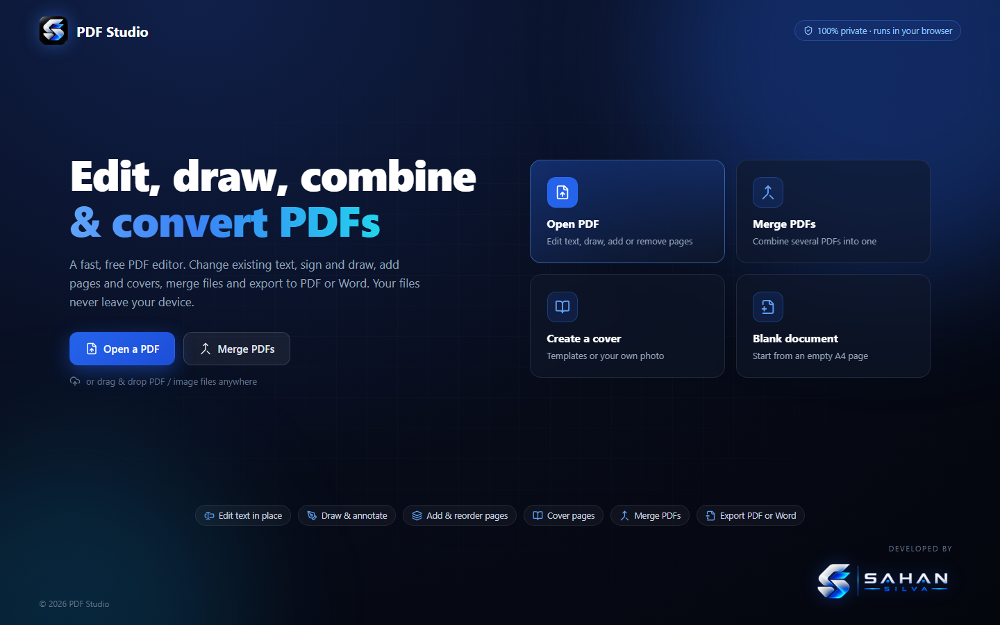
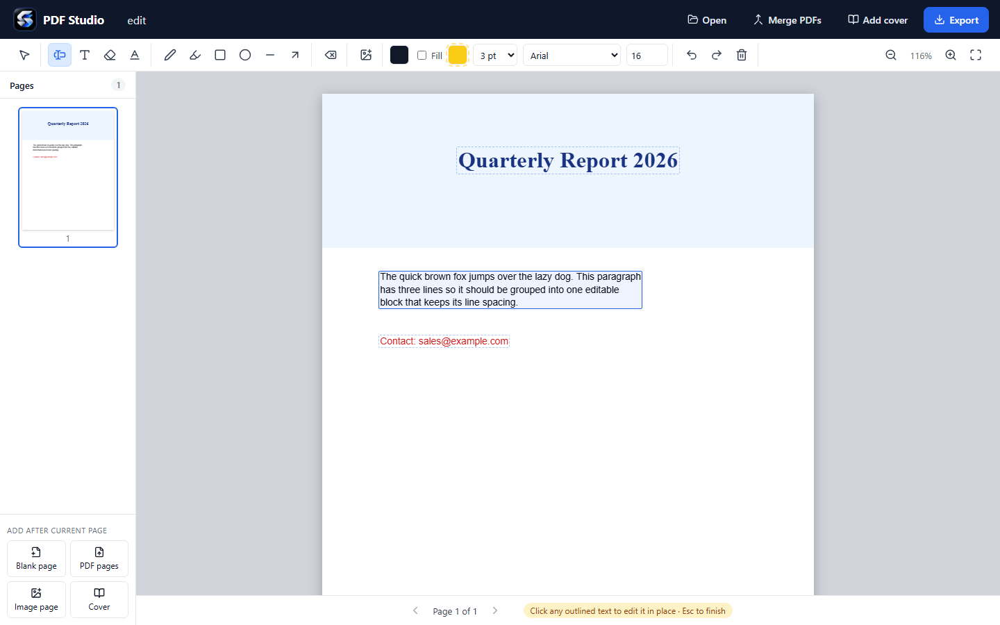
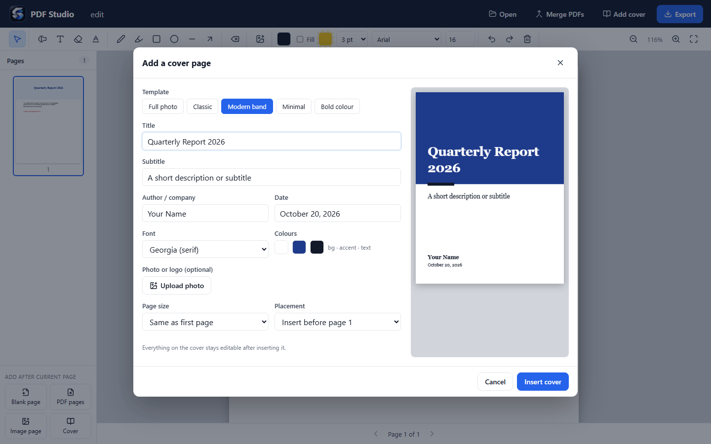

<p align="center">
  
</p>

<h1 align="center">PDF Studio</h1>

<p align="center">
  A free, private, browser-based PDF editor — edit existing text, draw, manage pages, add covers,<br />
  merge PDFs and export to <strong>PDF</strong> or <strong>Word (DOCX)</strong>.
</p>

<p align="center">
  <a href="https://sahansilvadev.github.io/PDFeditor/"><strong>🌐 Open PDF Studio online »</strong></a>
</p>

<p align="center">
  
  
  
  
</p>

<p align="center">
  
</p>

Everything runs locally in your browser. Your files are **never uploaded** to any server.

## ✨ Features

### ✏️ Edit existing PDF text — in place
- The **Edit text** tool outlines every line and paragraph on the page. Click one and type.
- The original **font** (e.g. Calibri Bold, Times), **size**, **colour**, **alignment**, **line spacing** and **background colour** are detected and matched automatically.
- Edited text stays **searchable and copyable** in the exported PDF.

<p align="center"></p>

### 🖊️ Draw & annotate
- Pen, highlighter pen, rectangle, ellipse, line and arrow, with colour, fill and line-width controls
- New text boxes, whiteout, area highlight, images and signatures
- Select / move / resize / delete objects, with per-page **undo & redo**

### 📄 Pages
- Thumbnails with **drag-and-drop reordering**
- Rotate, duplicate and delete pages
- Add **blank pages**, pages **from other PDFs**, or **images as pages**

### 📘 Cover pages
- 5 templates: **Full photo**, Classic, Modern band, Minimal, Bold colour
- Title, subtitle, author, date, colours, font and logo
- Use an uploaded **photo as the full-page cover** (with or without text). The page can match the photo's shape so nothing is cropped.
- The cover stays fully editable after inserting it

<p align="center"></p>

### 🔗 Merge PDFs
Combine any number of PDFs in the order you choose. Download the result directly, open it in the editor, or append it to the current document.

### 📤 Export
| Format | Details |
| --- | --- |
| **PDF** | Original content stays vector; edits and drawings are flattened on top at 216 dpi, with an invisible text layer for search/copy |
| **Word – Keep exact layout** | Every page becomes a picture in Word, so it looks identical |
| **Word – Editable text** | Text (including your edits) extracted into normal Word paragraphs |

Optional page range, e.g. `1-3, 5`.

## 🚀 Getting started

Requirements: [Node.js](https://nodejs.org/) 18 or newer.

```bash
git clone https://github.com/SahansilvaDev/PDFeditor.git
cd PDFeditor
npm install
npm run dev
```

Open http://localhost:5173 in your browser.

| Command | Description |
| --- | --- |
| `npm run dev` | Start the development server |
| `npm run build` | Type-check and build for production into `dist/` |
| `npm run preview` | Serve the production build locally |

The production build in `dist/` is a static site. It can be hosted on GitHub Pages, Netlify, Vercel or any web server.

### Deployment

Every push to `main` is built and published to GitHub Pages automatically by [`.github/workflows/deploy.yml`](.github/workflows/deploy.yml).

## ⌨️ Keyboard shortcuts

| Key | Action |
| --- | --- |
| `Ctrl` + `Z` / `Ctrl` + `Y` | Undo / redo (per page) |
| `Delete` | Delete selected objects |
| `Esc` | Finish editing / back to the select tool |
| `PgUp` / `PgDn` | Previous / next page |
| `Ctrl` + mouse wheel | Zoom |

Tips:
- Drag and drop PDF or image files anywhere on the window to open or add them.
- Click the **PDF Studio logo** to go back to the home screen. You are asked to confirm first.

## 🛠️ Tech stack

| Library | Used for |
| --- | --- |
| [React](https://react.dev/) + [Vite](https://vitejs.dev/) + TypeScript | App |
| [pdf.js](https://mozilla.github.io/pdf.js/) | Rendering pages and reading text / fonts |
| [Fabric.js](http://fabricjs.com/) | Editing and drawing layer |
| [pdf-lib](https://pdf-lib.js.org/) | Writing, merging and rotating PDFs |
| [docx](https://docx.js.org/) | Word export |
| [Zustand](https://github.com/pmndrs/zustand) | State management |
| [Lucide](https://lucide.dev/) | Icons |

### Project structure

```
src/
├── App.tsx                 app shell, dialogs, drag & drop
├── components/
│   ├── Home.tsx            home screen
│   ├── Editor.tsx          page canvas (pdf.js render + Fabric.js layer), in-place text editing
│   ├── Toolbar.tsx         tools and style controls
│   ├── Sidebar.tsx         page thumbnails and page operations
│   ├── CoverDialog.tsx     cover page designer
│   ├── MergeDialog.tsx     merge PDFs
│   └── ExportDialog.tsx    PDF / Word export
└── lib/
    ├── store.ts            document state (files, pages, page operations)
    ├── text.ts             text extraction, paragraph grouping, font detection
    ├── exportPdf.ts        PDF export and merging
    ├── exportDocx.ts       Word export
    ├── cover.ts            cover templates
    └── overlay.ts          edit-layer helpers (render, rotate, text runs)
```

## ⚠️ Known limitations

- **Edit text** covers the original text (using the sampled background colour) and places the new text on top. The original text is **still inside the PDF file**, so search/copy may find both the old and the new text. Do not use it to remove confidential information; that needs true redaction.
- The original font is used only if it is installed on your computer. Otherwise a similar font (Arial / Times New Roman / Courier New) is used.
- On photos or gradient backgrounds, the area behind edited text becomes a flat colour.
- Edits are flattened as an image in the exported PDF. The invisible search/copy text layer supports Latin characters.
- Word *Editable text* export simplifies formatting. Scanned PDFs (images only) contain no text to extract.

## 👤 Author

<p>
  <a href="https://github.com/SahansilvaDev">
    
  </a>
</p>

Developed by **[Sahan Silva](https://github.com/SahansilvaDev)**.
